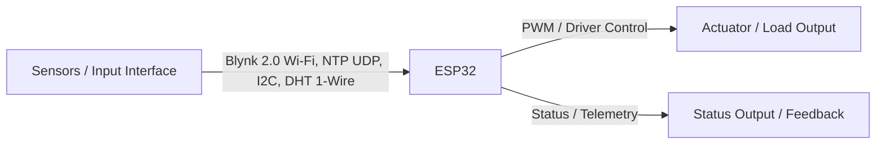

# ESP32 Smart Home Automation with NTP Real-Time Clock & Temperature Alerts

> **Embedded Hardware & Firmware Project | Graphic Era Hill University (B.Tech ECE 2023–2027)**  
> **Author:** Parth Dalakoti (*President, Robotics & Automation Club, GEHU*)  
> **Contact:** `parthdalakoti482@gmail.com` | [LinkedIn](https://linkedin.com/in/parthdalakoti)

---

## ⚡ Executive Engineering Summary
ESP32 IoT Home Automation Controller with NTP Network Real-Time Clock Sync, DHT Temperature Alerts, and Auto-Off Timers. This project is an independent engineering system designed, built, and tested by **Parth Dalakoti** during his B.Tech in Electronics & Communication Engineering.

---

## 🛠️ Hardware Stack & Specifications
* **Target Microcontroller:** `ESP32`
* **Primary Protocols & Interfaces:** `Blynk 2.0 Wi-Fi, NTP UDP, I2C, DHT 1-Wire`
* **Firmware Location:** [`firmware/`](firmware/)
* **Technical Documentation & Reports:** [`docs/`](docs/)
* **Hardware Wiring & Schematics:** [`hardware/`](hardware/)

---

## 🔌 Hardware Connections & Architecture

---

## 🚀 How to Build & Flash
1. Open the source code in [`firmware/`](firmware/) using **Arduino IDE** or **VS Code PlatformIO**.
2. Select target board: `ESP32`.
3. Configure serial baud rate (115200 or 9600 baud as defined in firmware).
4. Connect board and flash.

---

## 👨‍💻 Engineering Author
**Parth Dalakoti**  
*President, Robotics & Automation Club*  
*B.Tech in Electronics & Communication Engineering (2023–2027)*  
*Graphic Era Hill University (GEHU), Bhimtal Campus*  
*Contact:* `parthdalakoti482@gmail.com` • [GitHub Profile](https://github.com/ParthDalakoti)
